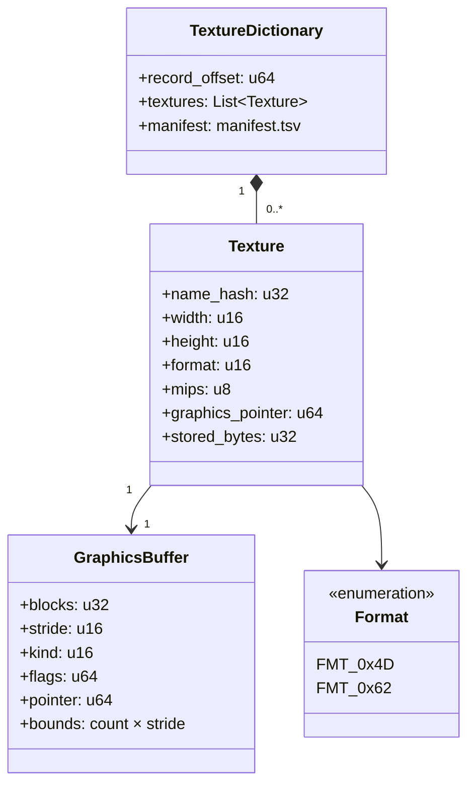
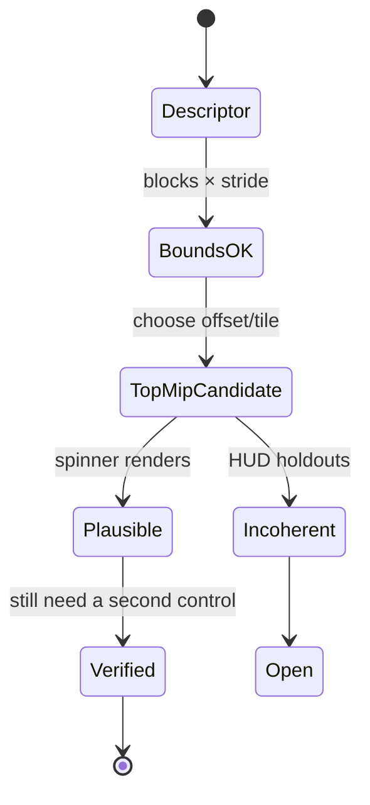
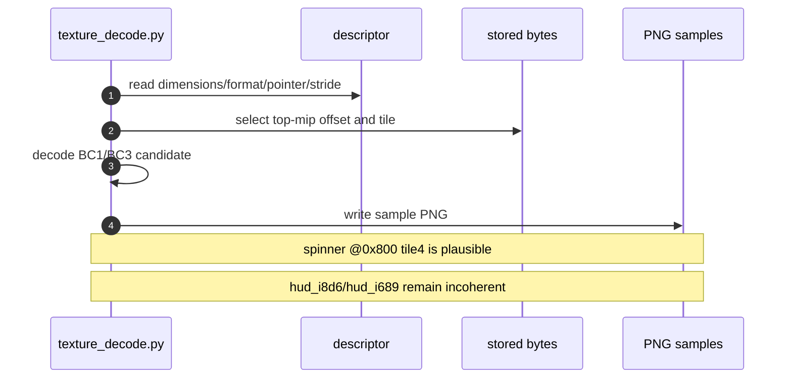

# Textures

Texture dictionaries are descriptor-backed. Their bounds, names, and
dimensions validate. One single-mip `0x4d` texture also has a verified BC3
decode and block layout.

## Descriptor model



The validated relation is:

```text
stored_bytes = blocks × stride
```

Dimensions, format code, hash, pointer, stride, and bounds agree. That is not a
pixel decode.

## Current corpus

| Item | Value |
| --- | ---: |
| valid dictionaries | 73 |
| textures | 788 |
| exported bytes | 306,008,064 |
| manifest | `output/data.rpf/textures-expanded/manifest.tsv` |
| formats | `0x4D`, `0x62` |

## Decode state



## Verified control

The `64×64` `trophy` texture in `textures.rpf` fills a single 4 KiB buffer
with 256 BC3 blocks starting at offset zero. All block addresses match the
low 4 KiB of the 2D 128-bpp standard swizzle. The decoded PNG and
reproduction command are listed in `handoff/texture-trophy-control.md`.

## Earlier top-mip experiment



## Open questions

- What are the actual top-mip offset and mip order?
- What is the row pitch for formats `0x4D` and `0x62`?
- Is the tile order 4×4 blocks, 16×16 pixels, or another layout?
- Which codec is used by `0x62`?
- Can a second independent texture verify the spinner candidate?

The spinner and HUD layouts remain open. The trophy control does not cover
multi-tile surfaces, packed mip tails, or format `0x62`.
