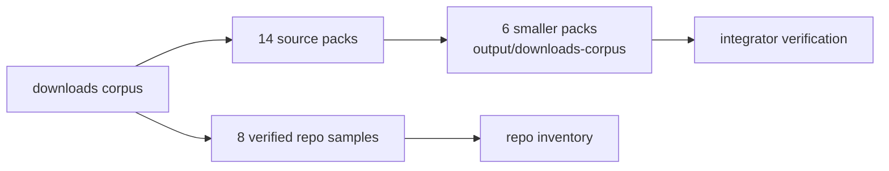

# Downloads corpus

the operator supplied the source tree `GTA6.Xbox.v1.0.2.1-CYBERLEEK`. The read-only
inventory counts **22 RPF9 files / 161,307,137,472 bytes**. All eight repository
samples match byte-for-byte.

The canonical large-file source is the external volume:

```text
CORPUS
```

It has the same 22 RPF9 files / 161,307,137,472 bytes and **619 GB free**. Use
it read-only for the remaining archives; do not copy a second corpus.

## Inventory

| Metric | Value |
| --- | ---: |
| RPF9 files | 22 |
| total bytes | 161,307,137,472 |
| verified archives | 14 |
| verified source bytes | 3,542,353,632 |
| remaining archives | 8 |
| remaining source bytes | 157,764,783,840 |



## Ownership boundary

The integrator verified the six additional smaller packs under
`output/downloads-corpus` in `f37b99f`. Coverage is now **14/22 archives** and
**3,542,353,632 source bytes**. The remaining eight archives total
**157,764,783,840 bytes**; the workspace volume has 81 GiB free.

Script does not start duplicate extraction jobs. This page is
metadata/inventory only.

Artifact: `handoff/downloads-corpus-inventory.tsv` (relative path, stored bytes,
magic, extraction manifest).

## Selective access to large archives

The anim.rpf pilot generated an index of 130,509 zlib streams. Each stream has
source offsets, decoded length, and a SHA-256 digest. Select a zlib row's start
offset to extract that payload. Gap rows preserve the location of bytes whose
contents have yet to be identified. Full archive extraction remains at 14/22.

```sh
python3 tools/stream_index.py "$archive" "$index"
python3 tools/stream_index.py "$archive" "$index" --offset "$start" --output "$payload"
```

The first command creates a new index. For the completed pilot, use the existing
`output/downloads-corpus/indexes/anim.tsv` with the second command.
