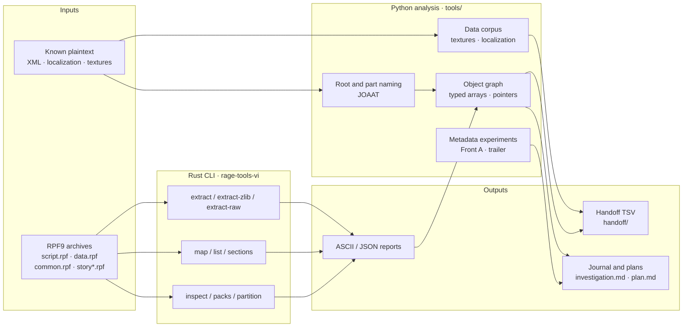
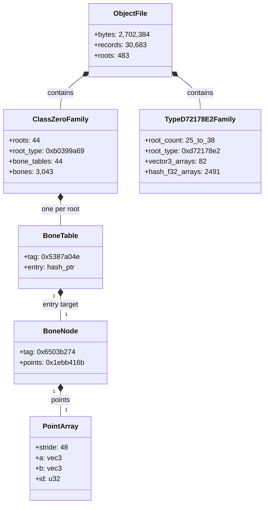

# Rage Tools VI

Reverse engineering of **GTA VI / Leonida RPF9 archives**, with the long-term
goal of enumerating every stored entry and decoding the bytes behind it.

!!! info "Documentation map"
    This site is the navigable model of the project. The append-only research
    record is `investigation.md` and the live check/todo list is `plan.md` at
    the repository root. The diagrams below are the UML/system view that ties those
    files together.

## First milestone

> One decoded record independently predicts the exact byte range of a payload
> that has already been checksum-verified.

The project is not there yet. The current verified blocks are the RPF9 byte
partitioning, the 42-stream script object, the typed array header, and the
class-0 bone table.

## System at a glance



## Current verified metrics

| Area | Value | State |
| --- | ---: | --- |
| Script object | 2,702,384 bytes, 42 zlib streams | checksum verified |
| Object records | 30,683 records, 483 roots | graph enumerated |
| Named roots | 306 / 483 | JOAAT matched |
| Data streams | 28,509 verified streams | manifest complete |
| Typed arrays | 7,960 arrays | complete inventory; weights sum to 1.0 |
| Class-0 bones | 3,043 bones / 44 tables | flattened |
| Skeleton families | 16 | near-identical hash sets |
| Vehicle roots | 385 / 306 named | 244 with mover curves |
| Vehicle mover curves | 1,935 / 244 roots | 36 channels; 6 named; units open |
| Bone points/edges | 15,732 entries | exported |
| Textures | 788 textures / 306,008,064 bytes | descriptor-valid |
| Front A | size model only | metadata cipher open |

## Two object families



## Start here

<div class="grid cards" markdown>

- :material-sitemap: **[Architecture overview](architecture/overview.md)**
  Components, boundaries, and data flow.
- :material-code-braces: **[Rust CLI](architecture/cli.md)**
  Report structs, command dispatch, and extraction sequence.
- :material-graph: **[Object graph](architecture/object-graph.md)**
  Records, pointers, typed arrays, and the class-0 bone hierarchy.
- :material-archive: **[RPF9 format](rpf9/format.md)**
  Header words, spans, zlib chains, and the metadata wall.
- :material-database: **[data.rpf](data/data-rpf.md)**
  Corpus layout, localization, textures, and named resources.
- :material-account-group: **[Collaboration](workstreams/collaboration.md)**
  The visible bus protocol, roles, and the current solo mode.

</div>

## Repository conventions

- Offsets are absolute archive offsets.
- Ranges are start-inclusive and end-exclusive.
- `*.rpf` samples and `output/` are local and untracked.
- `plan.md` is the live check/todo list; `investigation.md` is the append-only
  research record.
- Handoff artifacts live under `handoff/`.

```bash
# Build this site
python3 -m venv /tmp/mkdocs-venv
/tmp/mkdocs-venv/bin/pip install -r requirements-docs.txt
/tmp/mkdocs-venv/bin/mkdocs serve
```
