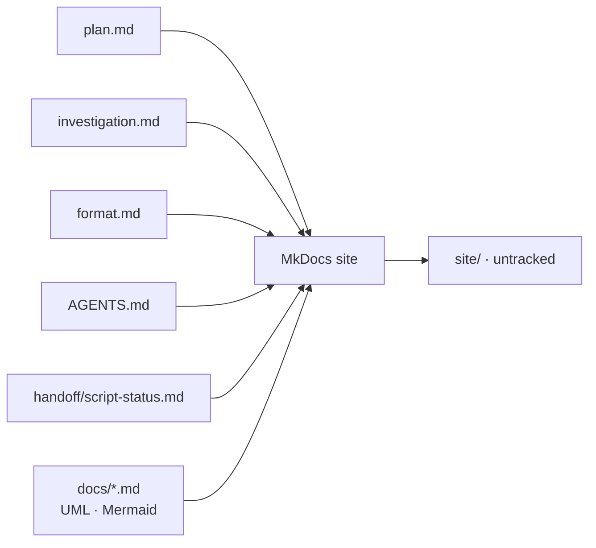
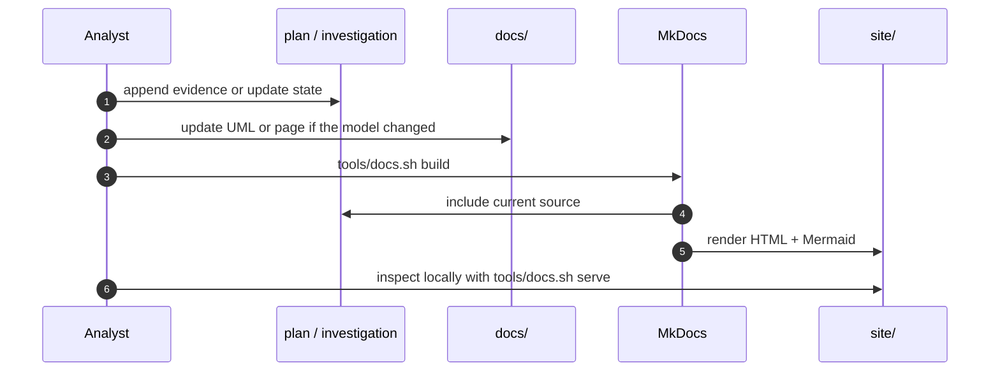

# Living documentation

This site is generated from the repository, not maintained as a separate copy.
The root files remain the source of truth; the site is a projection of them.

## Source of truth



The `include-markdown` plugin pulls the root files into the **Source documents**
section at build time. If a root document changes, the next build picks it up;
there is no second copy to update.

## What belongs in the docs

Findings go to `investigation.md`; state goes to `plan.md`; **caveats, environment
dependencies and lessons go here or next to the claim they qualify**. Three rules
earned the hard way:

1. **A claim carries its verification.** If a number was measured, say when and
   where; if it was inherited from an earlier session and not re-measured in this
   environment, say that too. The `id:29 | tags:3` per-stream word is the current
   example: it is documented from decoded evidence, and it has not been re-derived
   since the output volume went offline.
2. **Guard tests on the real condition.** `tests/test_analysis_tools.py` checked for
   `script.rpf` but not for `output/index/script.tsv`, so with the external volume
   unmounted the suite *failed* instead of skipping — while the README promised the
   opposite. A guard has to test everything the check actually needs.
3. **Record the environment.** `output/` is a symlink onto an external volume. With
   it unmounted, index-dependent checks skip and archive-side extractions are
   unavailable; that is a supported state, not a broken one, and the checks now say
   so explicitly.

## Update loop



## Commands

```bash
# One-time environment
python3 -m venv .venv-docs
.venv-docs/bin/pip install -r requirements-docs.txt

# Live preview
tools/docs.sh serve

# Clean build
tools/docs.sh build
```

`tools/docs.sh` uses `.venv-docs` by default; override with
`DOCS_VENV=/path/to/venv`.

## Rules for a new page

1. Add `docs/<section>/<page>.md`.
2. Add a nav entry in `mkdocs.yml`.
3. Prefer a UML diagram over prose for structure.
4. Link to a source document instead of copying it.
5. Run `tools/docs.sh build` and check the Mermaid rendering.
6. Keep `site/` and `.venv-docs/` untracked.

## CI

`.github/workflows/docs.yml` builds the site on push and pull request and
uploads the rendered `site/` as an artifact. A Pages deployment can be added
later without changing the source layout.

!!! note "Living, not generated truth"
    The site does not replace `investigation.md` or `plan.md`. Evidence is
    appended there first; the site explains and visualizes it.
