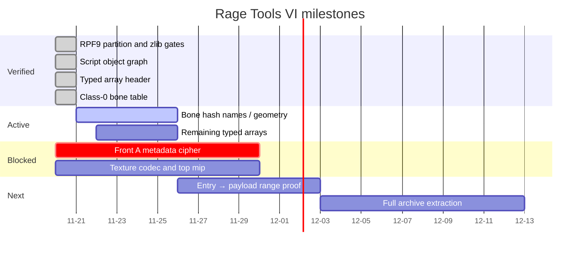
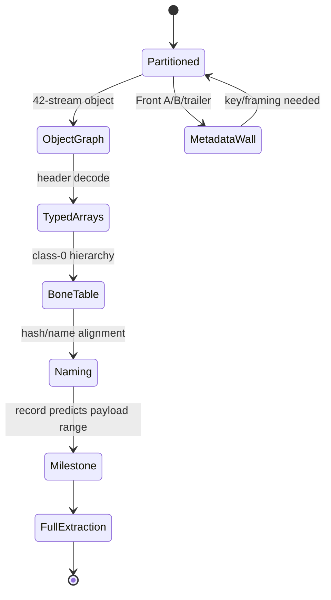

# Roadmap

The roadmap is a living section. `plan.md` remains the canonical todo/state;
this page is the visual projection.

## Milestones

## State

## Current work

| Priority | Task | Evidence | Blocker |
| --- | --- | --- | --- |
| 1 | Name or align the 612 bone hashes | `handoff/script-bones.tsv` | hash namespace |
| 2 | Geometry-classify bones | `handoff/script-bone-points.tsv` | no model orientation |
| 3 | Decode remaining typed arrays | `0xb066759f`, `0xb1ee00d0` | field semantics |
| 4 | Front A milestone | metadata size model | key/framing/decoded field |
| 5 | Texture top-mip verification | spinner + HUD holdouts | codec/pitch/tile |

## Done

- [x] Map `common.rpf` stored ranges and payload groups.
- [x] Verify the 42-stream object, PSIN records, XML, and story control.
- [x] Confirm metadata region sizes and header invariants.
- [x] Separate encrypted LSNS from plaintext sections.
- [x] Resolve the 64 KiB continuation rule.
- [x] Name 306 of 483 object roots with JOAAT.
- [x] Decode typed array headers and the `vector3` type tag.
- [x] Flatten the 44 class-0 bone tables and 3,043 bones.

## Parked

- 331,728-byte blob; revisit after a PC launch or new sample.
- Full RPF9 metadata key recovery; needs key material or a second build.
- Format `0x62` texture codec until a verified control exists.
