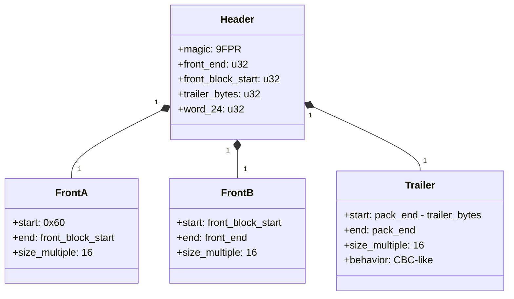
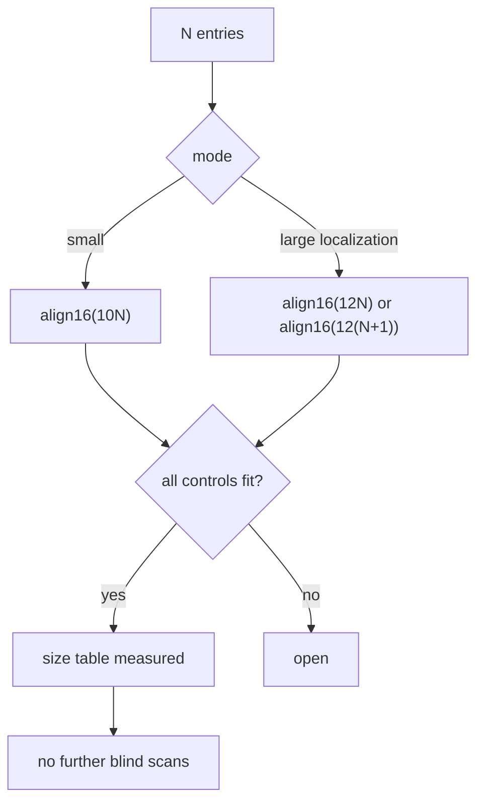
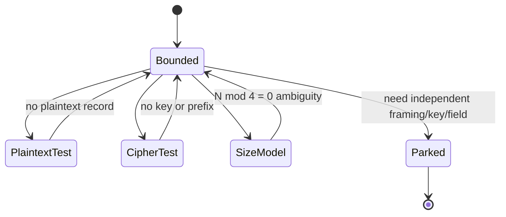
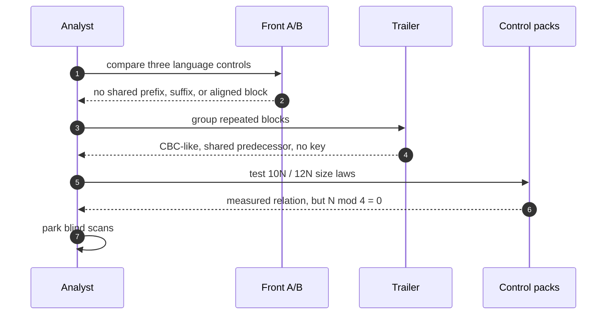

# Metadata regions

The metadata wall is the boundary between “the archive can be partitioned” and
“the archive index can be decoded.” The bytes are bounded, but Front A, Front B,
and the trailer are not plaintext.

## Region contract

| Region | Bounds | Observed property | Status |
| --- | --- | --- | --- |
| Front A | `0x60 .. word_08` | 16-byte multiple; no shared blocks across controls | cipher open |
| Front B | `word_08 .. word_04` | 32 bytes at N=2, 48 at N=4; large mode `align16(12(N+1))` | size model only |
| Trailer | `end - word_0c .. end` | CBC-like repeated blocks; no key | cipher open |

## Size model

For the small controls, the residual closes on `align16(10N)`. The large
localization mode uses `align16(12N)` or `align16(12(N+1))`. The discriminating
counts are both `N mod 4 = 0`, so the 12-byte-row, pad, and header/sentinel
rules coincide. A same-mode sample with `N mod 4 = 1` or `2` is still needed.

## Evidence state

## Attempt sequence

!!! warning "Do not scan blindly"
    The project has stopped unconstrained Front A scans. Reopen only with
    independent framing, key material, a decoded field, or a new same-mode
    sample that breaks the `N mod 4` ambiguity.
